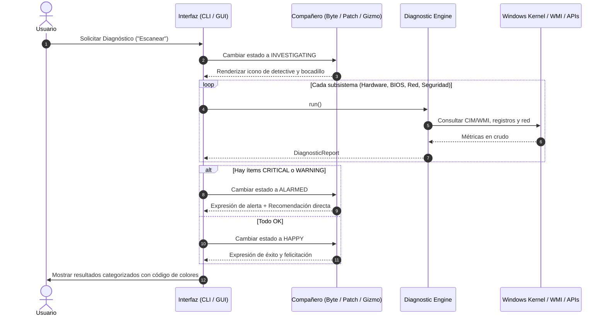
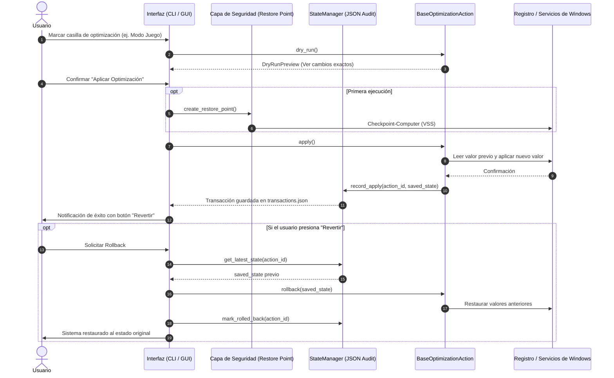

# Flujos Operativos y Comportamiento de ClarityPC

Este documento define la interacción entre el usuario, el motor de diagnóstico, las optimizaciones seguras y la máquina de estados de la mascota interactiva.

---

## 1. Flujo de Diagnóstico Completo (Read-Only)

---

## 2. Flujo de Optimización Segura (Con Rollback Garantizado)

---

## 3. Máquina de Estados del Compañero (Avatar)

La mascota no es solo un adorno gráfico; es un **intérprete semántico** del estado del PC:

| Estado (`CompanionMood`) | Disparador | Expresión Visual | Propósito |
| :--- | :--- | :---: | :--- |
| `IDLE` | Al iniciar la app sin acciones en curso. | 🐱 Durmiendo / Ronroneando | Transmitir tranquilidad y disponibilidad. |
| `INVESTIGATING` | Durante la ejecución de diagnósticos. | 🔍 Lupa / Detective | Indicar progreso de escaneo sin congelar la app. |
| `WORKING` | Aplicando TRIM, planes de energía o ajustes. | 🛠️ Casco / Llave inglesa | Notificar que se está modificando un ajuste de forma segura. |
| `ALARMED` | Al detectar TDR en GPU, XMP inactivo o virus. | 😿 Alerta / Cartel de advertencia | Explicar el fallo técnico en lenguaje humano sin asustar. |
| `HAPPY` | Tras optimizar o si el PC tiene salud 100%. | 😸 Alegre / Pulgar arriba | Reforzar que el sistema está en su mejor estado. |
| `EXPLAINING` | Al pasar el cursor sobre cualquier casilla. | 💡 Bombilla / Bocadillo | Educar al usuario sobre qué hace cada interruptor. |
